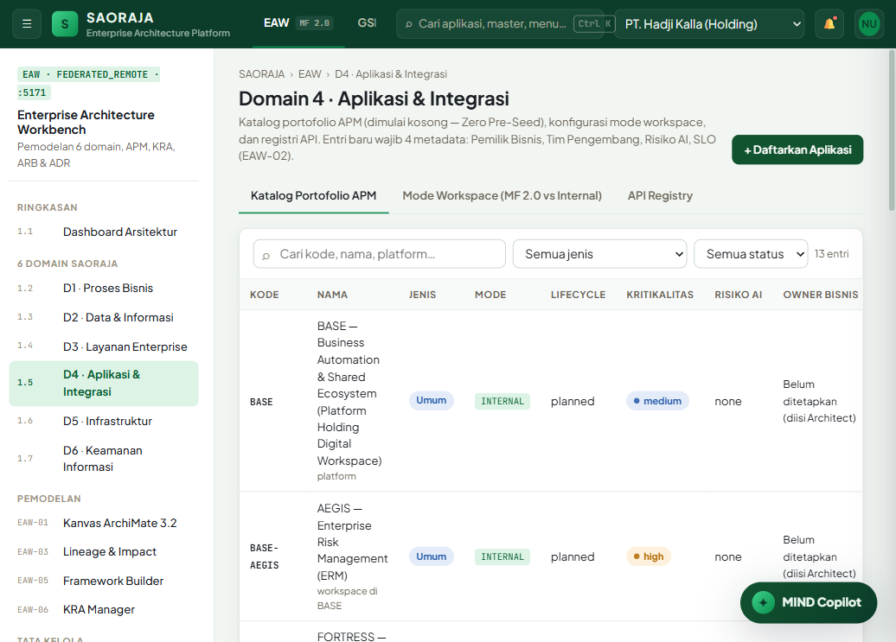
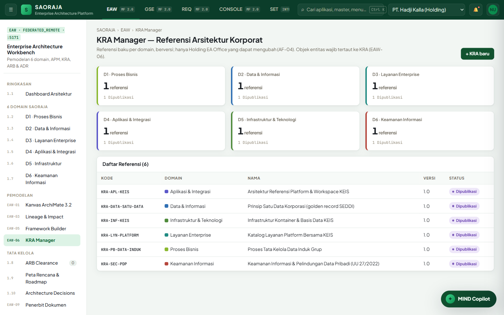
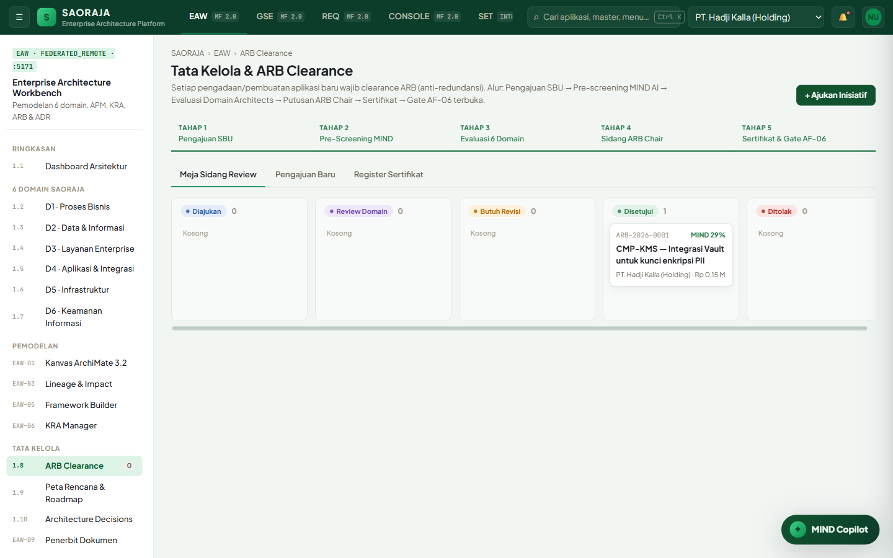
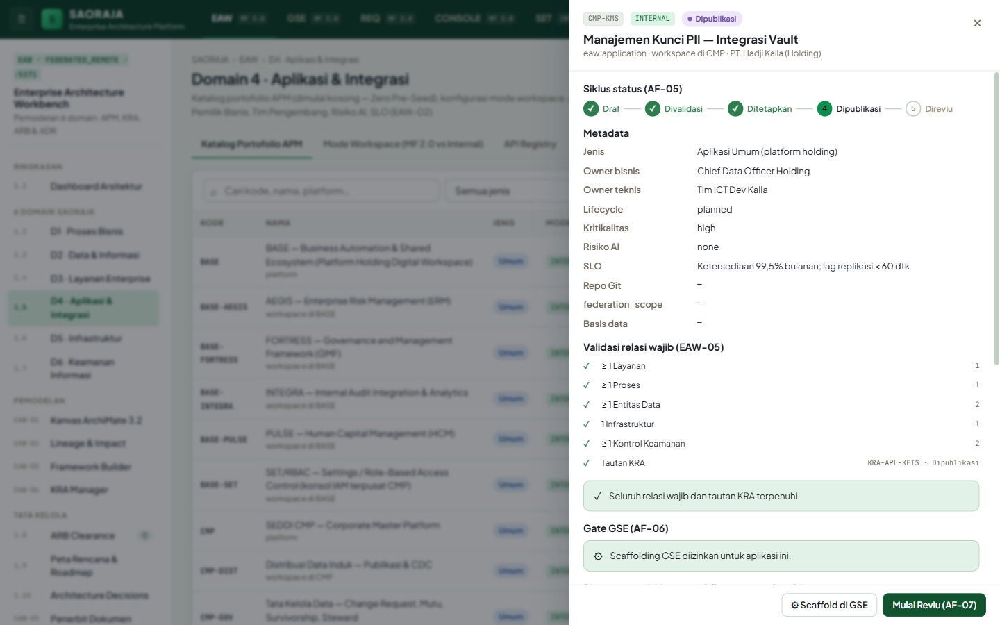
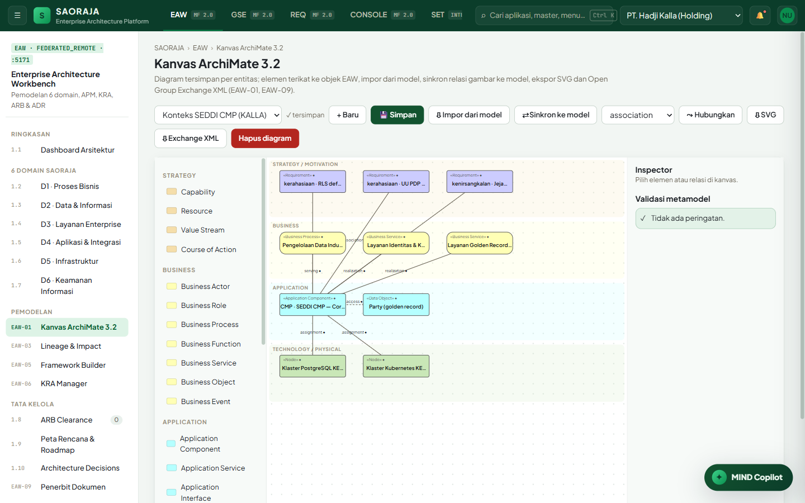
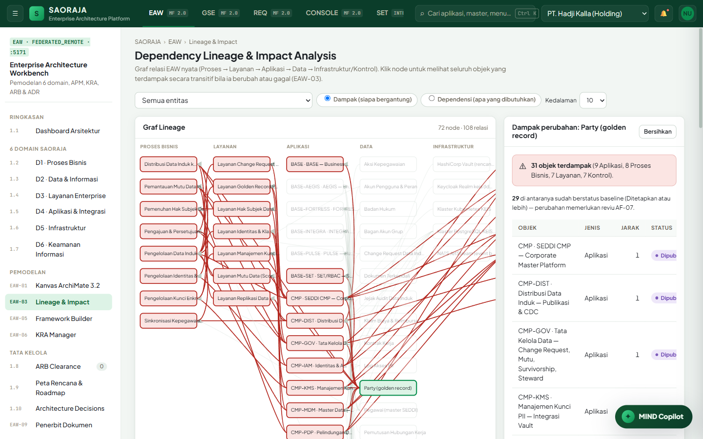
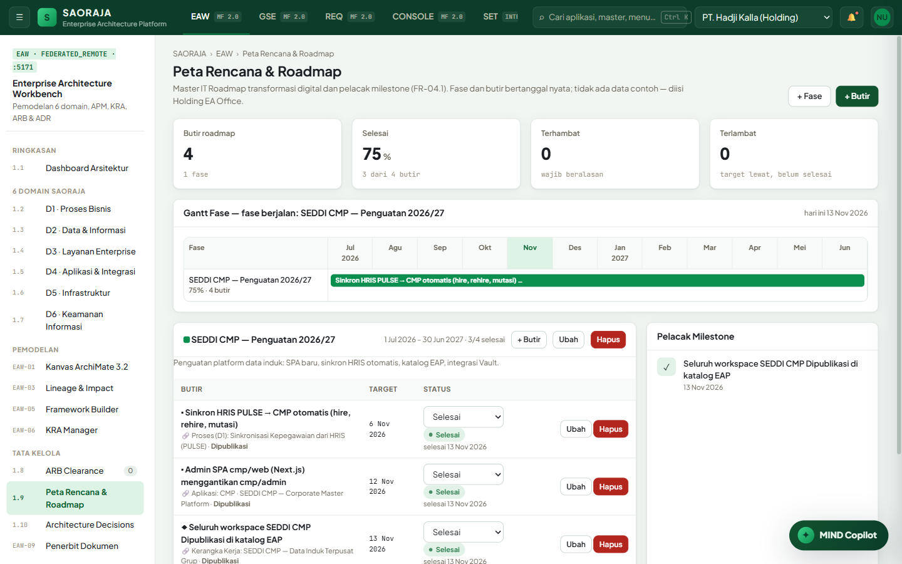
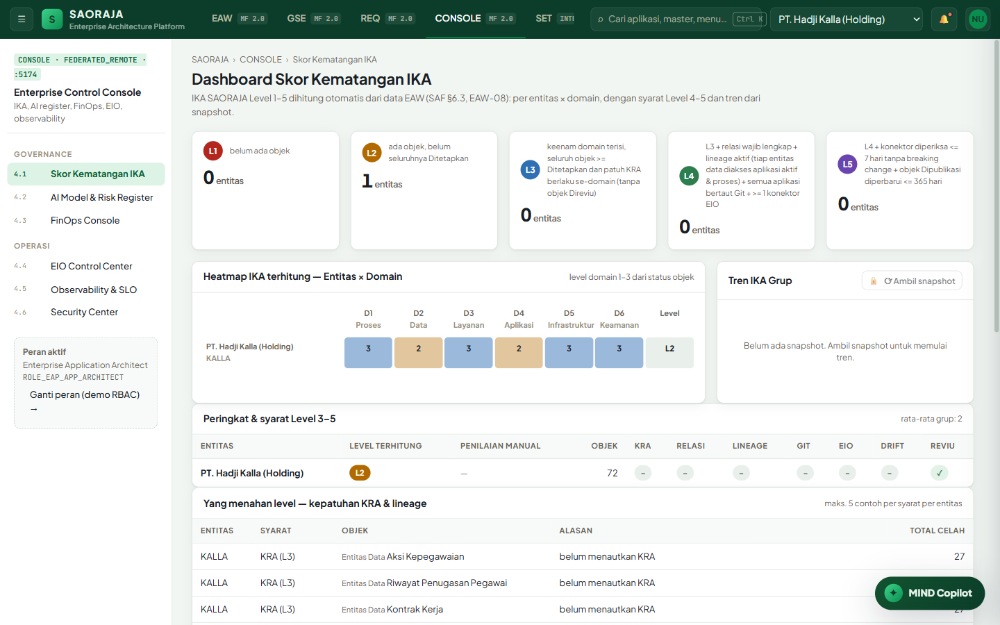

# Panduan Pengguna SAORAJA EAP — Ujung ke Ujung

Panduan ini menjelaskan cara memakai SAORAJA EAP (Enterprise Architecture Platform) dari awal sampai akhir. Contohnya memakai kasus nyata: **mendaftarkan SEDDI CMP** (Corporate Master Platform) ke katalog arsitektur grup sampai berstatus **Dipublikasi**, lalu terlihat kembali di CMP.

Seluruh data contoh di panduan ini sudah ada di stack dev. Data itu dimasukkan lewat API sebagai pengguna sungguhan oleh skrip `eap/scripts/sample-cmp-e2e.mjs` (lihat [§9](#9-menjalankan-data-contoh-cmp)). Semua yang terlihat di layar adalah hasil aturan sistem yang sebenarnya, bukan data mock.

---

## Daftar isi
1. [Apa itu EAP](#1-apa-itu-eap)
2. [Masuk ke EAP](#2-masuk-ke-eap)
3. [Peran dan wewenang](#3-peran-dan-wewenang)
4. [Konsep yang perlu dipahami](#4-konsep-yang-perlu-dipahami)
5. [Skenario ujung ke ujung: mendaftarkan SEDDI CMP](#5-skenario-ujung-ke-ujung-mendaftarkan-seddi-cmp)
6. [Setelah dipublikasi: perubahan dan reviu](#6-setelah-dipublikasi-perubahan-dan-reviu)
7. [Workspace lain: GSE, REQ, CONSOLE, SET](#7-workspace-lain-gse-req-console-set)
8. [Pesan galat yang sering muncul](#8-pesan-galat-yang-sering-muncul)
9. [Menjalankan data contoh CMP](#9-menjalankan-data-contoh-cmp)
10. [Batasan yang perlu diketahui](#10-batasan-yang-perlu-diketahui)

---

## 1. Apa itu EAP

EAP adalah tempat grup Kalla mencatat dan mengatur **arsitektur enterprise**: aplikasi apa saja yang ada, proses bisnis yang dilayaninya, data yang dipakainya, infrastruktur tempatnya berjalan, dan kontrol keamanannya. EAP terdiri dari lima workspace:

| Workspace | Fungsi |
|---|---|
| **EAW** — Enterprise Architecture Workbench | Katalog 6 domain arsitektur, KRA, ARB, ADR, kanvas ArchiMate, lineage, roadmap, penerbit dokumen. Panduan ini sebagian besar tentang EAW. |
| **GSE** — Generative Software Engineering | Membuat kerangka kode (scaffold) untuk aplikasi yang sudah lolos validasi, lalu push ke Git sebagai branch + PR. |
| **REQ** — Requirement Elicitation Assistant | Asisten AI untuk menyusun user story dan skenario Gherkin. |
| **CONSOLE** — Enterprise Control Console | Skor kematangan IKA, register AI, FinOps, mediasi integrasi EIO, observabilitas. |
| **SET** — Settings & RBAC | Struktur organisasi, akun, peran, audit trail. |

**Prinsip penting: Zero Pre-Seed.** Katalog aplikasi dimulai kosong. Setiap aplikasi masuk lewat proses yang sah, tidak pernah lewat seed database.

## 2. Masuk ke EAP

1. Buka **http://keis.localhost:8088** (stack dev). Di lingkungan lain, gunakan alamat yang diberikan tim infrastruktur.
2. Anda akan diarahkan ke halaman masuk **Kalla KEIS** (Keycloak). Masukkan nama pengguna dan kata sandi.
3. Setelah masuk, pilih **entitas kerja** di pemilih kanan atas, misalnya *PT. Hadji Kalla (Holding)*. Data yang tampil mengikuti cakupan entitas dan peran Anda.

Akun demo di stack dev (kata sandi `Kalla@2026`):

| Akun | Peran | Dipakai di panduan ini untuk |
|---|---|---|
| `nurul.aisyah` | Enterprise Application Architect | Menyusun data, memvalidasi, menerbitkan, mengajukan tiket ARB |
| `andi.pratama` | Chief Enterprise Architect / Ketua ARB | Menetapkan baseline, memutus tiket ARB, menerima ADR |
| `dewi.pdp` | Auditor | Membaca jejak dan audit |
| `iam.admin` | System Administrator | Menugaskan peran |

> Pengguna baru **tidak punya peran** sampai admin menugaskannya di **SET › Akun Pengguna**. Tanpa peran, menu terlihat tetapi tombol aksi terkunci.

Navigasi layar:
- Tab workspace ada di header (EAW, GSE, REQ, CONSOLE, SET).
- Menu tiap workspace ada di panel kiri. Tombol ☰ melipat panel ini.
- Kotak pencarian (`Ctrl K`) mencari aplikasi, master data, dan menu.

## 3. Peran dan wewenang

Wewenang ditegakkan di **database**, bukan hanya di layar. Kalau tombol terlihat tetapi Anda tidak berhak, sistem tetap menolak dengan pesan 403.

### 3.1 Aksi penting dan pemegang izinnya

| Aksi | Siapa yang boleh |
|---|---|
| Membuat platform | Enterprise Application Architect (`eaw.platform.write`) |
| Menempatkan workspace ke platform, menandai *adopsi* | Enterprise Application Architect (`eaw.workspace.assign`) |
| Menyusun/mengubah KRA di **KRA Manager** | Ketua ARB dan arsitek domain tingkat holding (`eaw.reference.write`); peran lain hanya membaca (`eaw.reference.read`) |
| Draf → **Divalidasi** | Arsitek domain dan Ketua ARB (`eaw.validation.approve`) |
| Divalidasi → **Ditetapkan** (termasuk KRA, kerangka kerja, dan status ADR *Accepted*) | Hanya Ketua ARB (`eaw.baseline.approve`). **Bukan penyusun objek itu** (empat mata). |
| Ditetapkan → **Dipublikasi** | Arsitek domain dan Ketua ARB (`eaw.publication.approve`) |
| Reviu berkala (Direviu → Draf/Divalidasi) | Arsitek domain dan Ketua ARB (`eaw.review.run`) |
| Mengajukan tiket ARB | Arsitek, termasuk SBU Architect (`gov.arb.write`) |
| Memutus tiket ARB | Ketua ARB, dan bukan pengaju tiket itu (`gov.arb.approve`) |
| Menyusun ADR | Arsitek domain dan SBU Architect (`eaw.adr.write`) |
| Menerbitkan dokumen resmi dan menyusun roadmap | Ketua ARB dan Enterprise Application Architect (`eaw.document.approve`, `eaw.roadmap.write`) |
| Mengubah atribut arsitektur entitas | Ketua ARB (`eaw.org.write`) |
| Menjalankan scaffolding GSE | Lead Software Engineer (`gse.project.run`); peran lain hanya melihat (`gse.project.read`) |
| Menjalankan sesi elisitasi REQ | Arsitek, SBU Architect, BPO, dan Lead Software Engineer (`req.session.write`) |
| Snapshot IKA | Ketua ARB dan System Administrator (`console.dashboard.write`) |
| Register AI dan kill-switch | Security Architect dan System Administrator (`console.ai.admin`, `console.security.admin`) |
| Mengelola konektor EIO | Infrastructure Architect, Application Architect, System Administrator (`console.eio.write`) |
| Menugaskan peran dan mengelola akun | System Administrator (`set.account.admin`) |

### 3.2 Melihat peran dan izin dalam satu layar

Buka **SET › Roles & Permissions**. Halaman ini hanya baca, karena katalog peran dan izin dikelola lewat seed (`eap/scripts/gen_seed_set.py`). Ada tiga tab:

| Tab | Isi |
|---|---|
| **Matriks Izin** | Semua peran aktif (baris) × seluruh katalog izin (kolom, dikelompokkan per workspace: CONSOLE, EAW, GOV, GSE, REQ, SET). Titik hijau berarti peran memegang izin itu. Baris peran Anda disorot. Kolom kanan menunjukkan jumlah izin per peran, dan baris bawah menunjukkan jumlah peran pemegang tiap izin. Arahkan kursor ke judul kolom untuk melihat kode dan deskripsi izin. |
| **RACI (turunan)** | Fitur (baris, mengikuti menu seperti KRA Manager, Framework Builder, Kanvas ArchiMate, Lineage, ARB, ADR, API Client) × peran (kolom). Nilainya **dihitung dari izin nyata**: **A** = memegang izin gerbang persetujuan fitur, **R** = izin tulis/jalankan/admin (**R\*** bila peran berlingkup entitas), **I** = hanya baca, **-** = tanpa akses. Tabel berubah otomatis saat izin peran berubah. |
| **N Peran** | Daftar peran sebagai tabel, dengan laci detail per peran. |

Catatan:
- **C (Consulted)** pada RACI PRD §13.2 adalah peran proses, bukan izin sistem. Karena itu C tidak dapat diturunkan dan tidak ditampilkan.
- Fitur tanpa izin persetujuan (misalnya ADR dan Roadmap) tidak punya kolom **A**.
- Izin baru di katalog otomatis muncul sebagai kolom di Matriks Izin. Agar ikut tampil di RACI, tambahkan fitur itu ke daftar `RACI_FEATURES` di `eap/web/src/modules/set-roles.tsx`.


## 4. Konsep yang perlu dipahami

### 4.1 Enam domain arsitektur

| Domain | Objek | Menu |
|---|---|---|
| D1 Proses Bisnis | Proses (level 1–3, berhierarki) | EAW › D1 · Proses Bisnis |
| D2 Data & Informasi | Entitas data (klasifikasi, PII, steward, sumber otoritatif) | EAW › D2 · Data & Informasi |
| D3 Layanan Enterprise | Layanan (internal / pelanggan-mitra, SLO) | EAW › D3 · Layanan Enterprise |
| D4 Aplikasi & Integrasi | Platform dan workspace | EAW › D4 · Aplikasi & Integrasi |
| D5 Infrastruktur | Aset (klaster K8s/DB, jaringan, cloud, DC) | EAW › D5 · Infrastruktur |
| D6 Keamanan Informasi | Kontrol per aspek (kerahasiaan, keutuhan, ketersediaan, keaslian, kenirsangkalan) | EAW › D6 · Keamanan Informasi |

### 4.2 Platform dan workspace
- **Platform** adalah induk, misalnya `CMP`. Platform wajib punya **standar UI/UX** dan **tech stack** sebelum bisa divalidasi.
- **Workspace** adalah bagian platform, misalnya `CMP-MDM`. Workspace wajib **ditempatkan di platform** dan punya **dasar pendaftaran**, salah satu dari:
  - **Adopsi**: sistem sudah beroperasi sebelum EAP ada, jadi bebas tiket ARB.
  - **Tiket ARB APPROVED** di entitas yang sama, untuk inisiatif baru.
- Workspace tidak boleh berstatus lebih tinggi dari platformnya. Workspace baru bisa Ditetapkan setelah platform minimal Ditetapkan, dan baru bisa Dipublikasi setelah platform Dipublikasi.

### 4.3 KRA — Referensi Arsitektur Korporat
KRA adalah standar baku per domain, dan setiap objek wajib menautkan KRA **dari domain yang sama**. Untuk naik ke Divalidasi, Ditetapkan, atau Dipublikasi, KRA itu harus sedang **berlaku** (berstatus Ditetapkan atau Dipublikasi). Karena itu KRA selalu disiapkan lebih dulu.

### 4.4 Alur status AF-05

```
Draf ──► Divalidasi ──► Ditetapkan ──► Dipublikasi ──► Direviu ──► (Divalidasi | Draf)
        EA Office       Ketua ARB       EA Office       saat KRA naik versi (AF-07)
```
- Objek hanya bisa disunting saat **Draf**. Setelah itu objek terkunci.
- Ke **Ditetapkan**, **Direviu**, atau kembali ke **Draf**: catatan minimal 5 karakter wajib diisi, misalnya nomor keputusan ARB.
- Setiap transisi tercatat permanen di riwayat (`eaw.workflow`, append-only). Riwayat ini tampil di laci detail.

### 4.5 Relasi wajib (EAW-05)
Aplikasi baru bisa **Divalidasi** bila punya minimal satu relasi ke masing-masing:

| Relasi | Contoh pada CMP-MDM |
|---|---|
| ≥ 1 Layanan | realisasi *Layanan Golden Record Party* |
| ≥ 1 Proses | melayani *Pengelolaan Data Induk Grup* |
| ≥ 1 Entitas Data | akses *Party*, *Badan Hukum*, *Unit Organisasi*, *Pegawai*, *Produk*, *Bagan Akun Grup* |
| ≥ 1 Infrastruktur | ditempatkan di *Klaster PostgreSQL KEIS* |
| ≥ 1 Kontrol Keamanan | *enkripsi PII pgcrypto + HMAC*, *RLS default-deny* |

Aturan lain:
- Sebuah **layanan** wajib terhubung ke minimal 1 proses.
- Sebuah **entitas data** wajib punya **steward** dan **sumber otoritatif**.
- Sebuah **kerangka kerja** wajib mencakup keenam domain.

## 5. Skenario ujung ke ujung: mendaftarkan SEDDI CMP

**Tujuan.** Mendaftarkan platform CMP beserta enam workspace-nya sampai Dipublikasi, lengkap dengan objek pendukung, tata kelola, dan dokumen.

**Hasil akhir yang sudah ada di stack dev:**
- 6 KRA
- 8 proses, 11 entitas data, 7 layanan, 5 aset infrastruktur, 7 kontrol
- 1 kerangka kerja
- 1 platform dan 6 workspace
- 83 relasi
- 1 tiket ARB, 3 ADR, 1 diagram, 1 fase roadmap dengan 4 butir, 1 dokumen terbit

Urutan langkah penting, karena setiap langkah bergantung pada langkah sebelumnya.



### Langkah 1 — Siapkan KRA keenam domain
*Peran: `nurul.aisyah` menyusun, `andi.pratama` menetapkan.*

1. Buka **EAW › KRA Manager**, lalu klik **+ KRA baru**.
2. Isi domain, kode, nama, dan versi. Contoh KRA untuk CMP:

   | Domain | Kode | Nama |
   |---|---|---|
   | proses_bisnis | `KRA-PB-DATA-INDUK` | Proses Tata Kelola Data Induk Grup |
   | data | `KRA-DATA-SATU-DATA` | Prinsip Satu Data Korporasi (golden record SEDDI) |
   | layanan | `KRA-LYN-PLATFORM` | Katalog Layanan Platform Bersama KEIS |
   | aplikasi | `KRA-APL-KEIS` | Arsitektur Referensi Platform & Workspace KEIS |
   | infrastruktur | `KRA-INF-KEIS` | Infrastruktur Kontainer & Basis Data KEIS |
   | keamanan | `KRA-SEC-PDP` | Keamanan Informasi & Pelindungan Data Pribadi |

3. Naikkan status setiap KRA:
   - **Ajukan Validasi** oleh penyusun.
   - **Tetapkan (ARB)** oleh Ketua ARB, dengan catatan keputusan.
   - **Publikasikan** oleh penyusun.



> Kalau langkah ini dilewati, validasi objek nanti ditolak dengan pesan *"KRA … belum berlaku"* atau *"berdomain lain"*.

### Langkah 2 — Isi objek domain (D1, D2, D3, D5, D6)
*Peran: `nurul.aisyah`.*

Buka setiap halaman domain, klik tombol **+** di kanan atas (misalnya **+ Tambah Proses**, **+ Entitas Data**, **+ Layanan**, **+ Aset Infrastruktur**, **+ Kontrol**), lalu isi formulir. Tautkan setiap objek ke **KRA domainnya**.

- **D1 Proses.** Buat proses induk dulu, misalnya *Pengelolaan Data Induk Grup* (L1). Setelah itu buat anak-anaknya (L2): *Pengajuan & Persetujuan Perubahan Data Induk*, *Pemantauan Mutu Data Induk*, *Distribusi Data Induk ke Platform Konsumen*, *Sinkronisasi Kepegawaian dari HRIS (PULSE)*.
- **D2 Data.**
  - Wajib isi **steward** dan **sumber otoritatif**, misalnya `kalla_cmp.mdm.parties`.
  - Tandai **PII** untuk data pribadi, dan pilih klasifikasi *terbatas* atau *rahasia* sesuai sensitivitasnya.
  - Cek dulu apakah entitas data yang sama sudah ada. Contohnya, *Pegawai (master SEDDI)* sudah didaftarkan untuk BASE dan **dipakai ulang**, tidak diduplikasi.
- **D3 Layanan.** Isi tipe, kategori, SLO, dan kanal, misalnya *Layanan Golden Record Party* dengan SLO *99,5% bulanan; p95 < 300 ms*.
- **D5 Infrastruktur.** Isi tipe, lokasi, dan tier DR, misalnya *Klaster PostgreSQL KEIS (kalla_cmp)* dengan Tier 1.
- **D6 Kontrol.** Isi aspek, standar rujukan, dan status penerapan (*belum*, *sebagian*, atau *penuh*).

### Langkah 3 — Buat kerangka kerja
*Peran: `nurul.aisyah`.*

Buka **EAW › Framework Builder**, klik **+ Kerangka Kerja**, lalu isi layanan utama: *SEDDI CMP — Data Induk Terpusat Grup* (tipe *utama*). Relasi yang Anda buat nanti bisa ditandai sebagai bagian dari kerangka ini. Kerangka baru bisa divalidasi kalau relasinya mencakup keenam domain.

### Langkah 4 — Daftarkan platform CMP
*Peran: `nurul.aisyah` (Enterprise Application Architect).*

1. Buka **EAW › D4 · Aplikasi & Integrasi**, lalu klik **+ Daftarkan Aplikasi**.
2. Pilih jenis node **platform**, lalu isi data berikut:
   - kode `CMP`, nama *SEDDI CMP — Corporate Master Platform*, entitas *PT. Hadji Kalla (Holding)*;
   - **4 metadata wajib**: Pemilik Bisnis, Tim Pengembang, Risiko AI, dan SLO;
   - **profil platform**: standar UI/UX dan tech stack (tanpa ini platform tidak bisa divalidasi).
3. Klik **Simpan**. Platform tercatat dengan status **Draf**.
4. Di laci detail, tautkan KRA `KRA-APL-KEIS` di bagian **Tautan KRA (syarat Divalidasi)**, lalu klik **Tautkan**.

### Langkah 5 — Daftarkan workspace: adopsi atau lewat ARB
*Peran: `nurul.aisyah`; Ketua ARB untuk tiket.*

**Workspace yang sudah beroperasi** (`CMP-MDM`, `CMP-GOV`, `CMP-PDP`, `CMP-IAM`, `CMP-DIST`): daftarkan sebagai **workspace** di platform `CMP` dan centang **adopsi**.

**Workspace baru** (`CMP-KMS` — integrasi Vault untuk kunci PII) wajib lewat **ARB Clearance**:
1. Buka **EAW › ARB Clearance**, lalu klik **Ajukan ke ARB**.
2. Isi nama inisiatif, *business case* (minimal 10 karakter), dan estimasi biaya. Sistem otomatis melakukan **pre-screening**:
   - **skor kemiripan** dengan aplikasi yang sudah ada (≥ 75 berarti berpotensi duplikasi);
   - **aturan M1 Satu Data**: tiket ditolak bila aplikasi berencana membuat tabel master lokal (customer, vendor, employee, party, product, coa, branch).
3. **Ketua ARB** (bukan pengaju) memindahkan tiket ke **IN_REVIEW**, lalu ke **APPROVED** dengan catatan minimal 10 karakter. Sertifikat `CERT-ARB-<tahun>-<nomor>` terbit otomatis.
4. Daftarkan `CMP-KMS` sebagai workspace di platform `CMP` dan pilih tiket ARB yang sudah APPROVED itu.



### Langkah 6 — Hubungkan relasi wajib
*Peran: `nurul.aisyah`. Lakukan selagi aplikasi masih Draf.*

1. Buka laci detail aplikasi, misalnya `CMP-MDM`.
2. Di bagian **Relasi ArchiMate**, gunakan tombol **+ Layanan**, **+ Proses**, **+ Entitas Data**, **+ Infrastruktur**, **+ Kontrol**. Pilih objek yang sudah ada, atau ketik nama untuk membuat objek baru secara cepat.
3. Bagian **Validasi relasi wajib (EAW-05)** di laci menunjukkan ✓ atau ✕ untuk setiap syarat. Tombol **Ajukan Validasi** baru akan berhasil kalau semuanya ✓.

Relasi antar-aplikasi juga dicatat, karena menentukan analisis dampak. Pada CMP:
- `CMP-IAM` **melayani** `BASE-SET`, karena konsol IAM BASE memakai IAM pusat.
- `CMP-DIST` **mengalirkan data** ke platform `BASE`, karena BASE menerima replika `ref.*`.



### Langkah 7 — Jalankan alur AF-05
Urutan yang benar:
1. **Objek domain**: proses, data, layanan, infrastruktur, kontrol.
2. **Platform** `CMP`.
3. **Workspace**.
4. **Kerangka kerja**.

Untuk setiap item, buka laci detailnya lalu klik tombol di kaki laci:

| Tombol | Oleh | Catatan |
|---|---|---|
| **Ajukan Validasi** | `nurul.aisyah` | Sistem memeriksa KRA se-domain yang berlaku, relasi wajib, profil platform, serta penempatan dan dasar workspace. |
| **Tetapkan (ARB)** | `andi.pratama` | Wajib catatan keputusan. Ditolak bila Anda adalah penyusun objek itu. |
| **Publikasikan** | `nurul.aisyah` | Aplikasi yang Dipublikasi otomatis masuk **registri aplikasi** dan direplikasi ke CMP (lihat Langkah 14). |

### Langkah 8 — Catat keputusan arsitektur (ADR)
1. Buka **EAW › Architecture Decisions**, lalu buat ADR baru (status awal *Proposed*). Contoh:
   - **CMP-ADR-001**: CMP sebagai sumber tunggal data induk; konsumen membaca replika `ref.*`.
   - **CMP-ADR-002**: PII dienkripsi pgcrypto dengan pencarian HMAC; kunci di Vault.
   - **CMP-ADR-003**: IAM terpusat KEIS di CMP; klaim dibaca per workspace.
2. Tautkan ADR ke objek terkait, misalnya aplikasi, entitas data, atau kontrol.
3. **Ketua ARB** mengubah status menjadi **Accepted**. Setelah Accepted, isi ADR terkunci. Kalau keputusan berubah, buat ADR baru yang menggantikannya (*Superseded*).
4. Opsional: **⇧ Terbitkan ke Git (PR/MR)** di laci ADR membuat PR berisi berkas Markdown ADR (butuh konektor GitHub/GitLab).

### Langkah 9 — Gambarkan di kanvas ArchiMate
1. Buka **EAW › Kanvas ArchiMate 3.2**, lalu buat diagram dengan **+ Baru**, misalnya *Konteks SEDDI CMP*.
2. Klik **Impor dari model**, lalu pilih objek `CMP`. Objek itu beserta seluruh objek yang berelasi dengannya ditempatkan otomatis per lapisan, dan setiap node **terikat** ke objek EAW nyata.
3. Panel **Validasi metamodel** menampilkan peringatan ArchiMate.
4. **Sinkron ke model** mengubah garis yang Anda gambar antar-node terikat menjadi relasi EAW.
5. Ekspor dengan **SVG** atau **Exchange XML**. File Exchange XML divalidasi terhadap skema resmi ArchiMate 3.1.



### Langkah 10 — Analisis dampak (lineage)
Buka **EAW › Lineage & Impact**, lalu klik sebuah node. Contohnya, klik *Party (golden record)* untuk melihat semua objek yang **terdampak** kalau data itu berubah atau gagal. Pada data contoh, hasilnya 30 objek dalam 3 tingkat, termasuk workspace BASE. Pilih **Dependensi** untuk melihat arah sebaliknya: apa saja yang dibutuhkan sebuah objek. Objek di luar cakupan akses Anda dihitung jumlahnya, tetapi tidak ditampilkan namanya.



### Langkah 11 — Masukkan ke Master IT Roadmap
Buka **EAW › Peta Rencana & Roadmap**.
1. Klik **+ Fase**, misalnya *SEDDI CMP — Penguatan 2026/27* (1 Jul 2026 – 30 Jun 2027).
2. Klik **+ Butir** untuk setiap deliverable atau milestone. Isi tanggal target dan status. Opsionalnya, tautkan objek EAW sebagai bukti, misalnya butir *Integrasi Vault* ditautkan ke `CMP-KMS`.

Aturan yang berlaku:
- Target butir harus berada dalam rentang fase.
- Status *terhambat* wajib disertai catatan.
- Status *terlambat* dihitung otomatis.



### Langkah 12 — Terbitkan dokumen arsitektur
Buka **EAW › Penerbit Dokumen**, pilih cakupan **kerangka kerja** SEDDI CMP, lalu pilih format HTML atau Markdown.
1. Klik **Pratinjau**. Pratinjau boleh memuat objek Draf.
2. Klik **⇧ Terbitkan resmi**. Dokumen resmi disusun ulang di server dari objek baseline saja (status ≥ Ditetapkan), diberi nomor versi, dan dicatat dengan sha256.
3. Untuk HTML, tersedia unduhan **PDF**.

### Langkah 13 — Pantau kematangan (IKA)
Buka **CONSOLE › Skor Kematangan IKA**. Level 1–5 per entitas × domain dihitung otomatis dari data EAW. Kartu **"Yang menahan level"** menjelaskan kekurangan yang menahan level, misalnya objek tanpa KRA berlaku atau data tanpa lineage aktif. Peran lihat-semua bisa menyimpan **snapshot** untuk melihat tren.



### Langkah 14 — Bukti: CMP mengenali dirinya lewat EAP
Begitu sebuah aplikasi **Dipublikasi**, EAP menulisnya ke registri aplikasi. Registri itu direplikasi ke database CMP (`kalla_cmp.ref.applications`) lewat publikasi `pub_eap_ref`. Di stack dev, ketujuh aplikasi CMP muncul di sana kurang dari satu detik setelah dipublikasi:

```
CMP|platform|active
CMP-DIST|workspace|active
CMP-GOV|workspace|active
CMP-IAM|workspace|active
CMP-KMS|workspace|planned
CMP-MDM|workspace|active
CMP-PDP|workspace|active
```

Dengan ini lingkarannya tertutup. CMP (sumber data induk) menyediakan organisasi dan pengguna untuk EAP, lalu EAP mengembalikan katalog aplikasi resmi ke CMP.

## 6. Setelah dipublikasi: perubahan dan reviu

- **Objek Dipublikasi terkunci.** Untuk mengubahnya, objek harus melewati **Direviu**, lalu dikembalikan ke **Draf** (dengan catatan), disunting, dan dinaikkan lagi lewat alur AF-05.
- **KRA naik versi (AF-07).** Saat versi KRA dinaikkan, semua objek Dipublikasi yang menautkannya **otomatis berpindah ke Direviu** di seluruh grup. Formulir ubah KRA menampilkan pratinjau **Dampak AF-07** sebelum disimpan. Objek itu baru bisa divalidasi ulang setelah KRA versi baru Dipublikasi lagi.
- **Gate GSE (AF-06).** Scaffolding kode di GSE hanya diizinkan untuk aplikasi minimal **Divalidasi**. Percobaan untuk aplikasi Draf ditolak dan tercatat sebagai *blocked*.

## 7. Workspace lain: GSE, REQ, CONSOLE, SET

| Workspace | Alur singkat |
|---|---|
| **GSE › Proyek Scaffolding** | Pilih aplikasi (minimal Divalidasi), pilih templat, lalu buat proyek. Sistem menjalankan gerbang lokal: pii-guard dan manifest. Kode lalu bisa disunting di **Web IDE** dan di-push sebagai branch + PR. Tidak pernah ada push ke `main`. Bantu AI opsional; kode hasil AI wajib direviu manusia. |
| **GSE › Agent & Saga Flow Builder** | Susun flow saga: setiap langkah yang mengubah data wajib punya kompensasi dan idempotency key. Uji dengan **simulate** sebelum live. |
| **REQ › Sesi Elisitasi** | Ceritakan kebutuhan. Teks Anda disamarkan PII-nya lebih dulu, lalu diperiksa guardrail, baru dijawab asisten. Hasilnya user story + Gherkin (minimal 2 skenario). |
| **CONSOLE › EIO Control Center** | Daftarkan model kanonikal dan rute integrasi. Aturan bisnis rute mendukung `regex` dengan mesin **RE2 (waktu linear)**: tanpa backreference/lookaround, pengulangan maksimal `{100}`, input maksimal 1.024 karakter, maksimal 10 aturan regex per rute. Coba dengan **simulate** sebelum mengaktifkan rute. |
| **SET** | Admin menugaskan peran di **Akun Pengguna**. **Roles & Permissions** menampilkan Matriks Izin dan RACI turunannya (lihat [§3.2](#32-melihat-peran-dan-izin-dalam-satu-layar)). **Audit Trail** menampilkan jejak perubahan. |

## 8. Pesan galat yang sering muncul

| Pesan | Arti | Yang dilakukan |
|---|---|---|
| *validasi ditolak: … belum tertaut ke referensi KRA* | Objek belum menautkan KRA. | Tautkan KRA dari domain yang sama. |
| *KRA … berdomain "x", bukan "y"* | KRA salah domain. | Kembalikan objek ke Draf, lalu tautkan KRA yang benar. |
| *transisi ke … ditolak: KRA … belum berlaku* | KRA masih Draf atau sedang Direviu. | Tetapkan dan publikasikan KRA lebih dulu. |
| *kekurangan relasi/atribut wajib: minimal 1 …* | Syarat EAW-05 belum terpenuhi. | Tambahkan relasi yang disebut di pesan. |
| *penyusun objek tidak boleh menetapkan objeknya sendiri* | Aturan empat mata. | Minta Ketua ARB lain yang menetapkan. |
| *workspace … tidak boleh melampaui platform induk* | Platform belum cukup tinggi statusnya. | Naikkan status platform lebih dulu. |
| *workspace … wajib tertaut tiket ARB APPROVED (atau ditandai adopsi)* | Workspace belum punya dasar pendaftaran. | Ajukan tiket ARB, atau tandai adopsi (khusus App Architect). |
| *Melanggar Prinsip Satu Data Korporasi* (ARB) | Inisiatif berencana membuat master lokal. | Konsumsi data dari replika `ref.*` atau API SEDDI. |
| *catatan (min. 5 karakter) wajib* | Transisi butuh alasan. | Isi nomor keputusan ARB atau alasan revisi. |
| **403** di halaman SET untuk arsitek | Peran Anda tidak punya izin baca akun atau audit. | Normal. Hubungi admin bila memang perlu. |
| **412** *Data sudah berubah* saat menyimpan | Data sudah diubah orang lain sejak Anda membukanya. | Muat ulang, lalu ulangi perubahan. |

## 9. Menjalankan data contoh CMP

Skrip ini memasukkan seluruh skenario di §5 lewat API, sebagai `nurul.aisyah` dan `andi.pratama`, dengan semua aturan sistem berlaku. Skrip ini **bukan seed**: polanya sama dengan pendaftaran BASE.

```bash
# stack dev Compose berjalan (gateway :8088, Keycloak :8180)
node eap/scripts/sample-cmp-e2e.mjs
```

- **Idempoten**: aman dijalankan ulang. Objek yang sudah ada dipakai ulang, dan transisi hanya bergerak maju dari status saat ini. Jalan kedua mencetak *0 dibuat, 0 transisi*.
- **Variabel opsional**: `EAP_GW`, `EAP_HOST`, `KC_URL`, `KC_HOST`, `KC_CLIENT`, `E2E_PASSWORD`, `ENTITY_CODE`, `PG_EXEC`, `SKIP_CMP_CHECK=1`.
- **Langkah terakhir** memverifikasi bahwa ketujuh aplikasi CMP muncul di `kalla_cmp.ref.applications`. Kode keluar 1 bila tidak.

## 10. Batasan yang perlu diketahui

- **Nama pelaku di riwayat transisi**: pengguna tanpa izin baca akun (`set.account.read`) melihat potongan id untuk pelaku lain, bukan nama akunnya.
- **ADR D-01..D-14** di halaman Architecture Decisions adalah keputusan SAF historis yang ditampilkan dari berkas. Hanya ADR lain (mis. `CMP-ADR-*`) yang berasal dari database.
- **Skor ARB** adalah kemiripan leksikal (pg_trgm), bukan model AI MIND.
- **Lint/build/SCA/SBOM di GSE** tercatat *skipped* karena butuh runner CI. Kode hasil scaffold atau AI belum dikompilasi di EAP.
- **Saga GSE dan mediasi EIO** berjalan sinkron di dalam permintaan (eksekutor ringan, bukan Temporal/Kafka). Di dev belum ada layanan KEIS nyata yang terdaftar sebagai target live.
